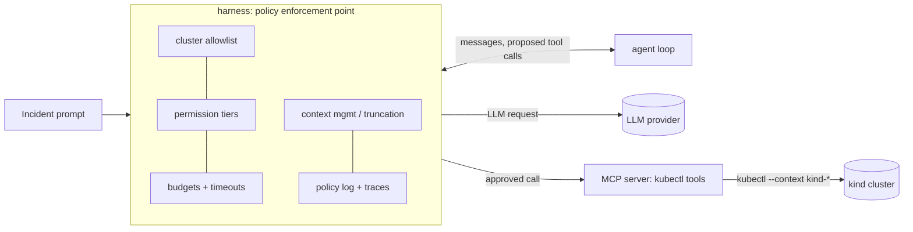

# k8s-triage-harness

An agent that finds the root cause of Kubernetes incidents, inside a production-grade harness: sandboxing, permission tiers, context management, budgets, eval-gated CI, OpenTelemetry traces and prompt-injection defence. It's benchmarked on injected faults with known root causes against a rule-only baseline, k8sgpt and HolmesGPT.

> **Status:** M0 (scaffold) and M1 (fault library, 12 faults) are done; the agent starts in M2. See [PROGRESS.md](PROGRESS.md). No results are claimed until CI produces them.

## Why
Most "AI for Kubernetes" demos show the model. Production depends on the harness: what the agent is allowed to touch, how much it can spend, how it handles hostile log text, and whether a prompt change silently breaks it. This repo measures all of that.

## Architecture

- The **harness** is the only component that talks to the LLM and, through the MCP tools, to the cluster ([ADR-001](docs/adr/001-architecture.md)). Built so far: the cluster allowlist ([ADR-002](docs/adr/002-cluster-allowlist.md)). It accepts a context only if its name is `kind-*`/`k3d-*` **and** its API server is local https; anything else fails closed.
- The **fault library** is the benchmark: broken scenarios with known root causes, each verified on a real kind cluster in CI ([ADR-003](docs/adr/003-fault-library.md)).

## Results
_Filled from CI eval runs (M4+)._

| Agent | Category accuracy | Evidence grounding | Cost / incident | p95 latency |
|---|---|---|---|---|
| Rule-only baseline | – | – | – | – |
| This agent | – | – | – | – |
| k8sgpt | – | – | – | – |
| HolmesGPT | – | – | – | – |

## Fault library
Each fault is a folder in [`faults/`](faults/): manifests, `inject.sh`, `check.sh` (asserts the **symptom**), `reset.sh`, `truth.yaml` (category, root cause, evidence, fix) and a short README. Namespaces and names are neutral, so the cluster never reveals the answer; a test enforces this. CI ([faults.yml](.github/workflows/faults.yml)) runs every fault on its own fresh kind cluster. The check must fail before inject, pass after inject, and fail again after reset.

| Fault | Category | Symptom the check asserts | Requires |
|---|---|---|---|
| [image-pull-bad-tag](faults/image-pull-bad-tag) | `image_pull` | pods in ErrImagePull / ImagePullBackOff | – |
| [bad-command-wrong-path](faults/bad-command-wrong-path) | `bad_command` | CrashLoopBackOff, non-zero exit | – |
| [oom-low-memory-limit](faults/oom-low-memory-limit) | `oom` | container terminated OOMKilled | – |
| [probe-wrong-path](faults/probe-wrong-path) | `probe_misconfig` | restarts after "Liveness probe failed" | – |
| [service-selector-mismatch](faults/service-selector-mismatch) | `selector_mismatch` | Service has no endpoints while pods are Ready | – |
| [service-port-mismatch](faults/service-port-mismatch) | `port_mismatch` | endpoints exist, client gets "Connection refused" | – |
| [pvc-unknown-storageclass](faults/pvc-unknown-storageclass) | `pvc_unbound` | PVC Pending, pod unschedulable | – |
| [configmap-missing](faults/configmap-missing) | `config_missing` | CreateContainerConfigError | – |
| [networkpolicy-blocks-client](faults/networkpolicy-blocks-client) | `network_policy` | endpoints exist, client requests never connect | – |
| [dns-policy-default](faults/dns-policy-default) | `dns` | Service healthy, its DNS name doesn't resolve from the client | – |
| [rbac-missing-permission](faults/rbac-missing-permission) | `rbac_forbidden` | app logs HTTP 403 "cannot list resource" | – |
| [hpa-missing-requests](faults/hpa-missing-requests) | `hpa_misconfig` | HPA reports "missing request for cpu" | metrics-server |

Not covered yet (planned for the 12 → 20 growth): `quota_exceeded`, `scheduling_taint`, `ingress_backend_timeout`, `tls_secret`. The two ingress categories wait for an ingress-controller decision, because ingress-nginx is retired ([ADR-003](docs/adr/003-fault-library.md)).

## How to run
Prerequisites: Linux or WSL2, Docker, [uv](https://docs.astral.sh/uv/) and bash 4.4+. `make tools` installs the pinned, checksum-verified kind, kubectl, kubeconform and actionlint (linux-amd64) into `~/.local/bin`, replacing any versions already there; set `BIN_DIR=...` to install elsewhere.

```bash
make setup            # pinned Python deps (uv.lock)
make lint test        # ruff, mypy, yamllint, shellcheck; unit tests (no cluster needed)
make tools validate   # pinned CLIs; kubeconform + actionlint

make cluster                               # kind cluster "triage" -> context kind-triage
make addons NAME=hpa-missing-requests      # only for faults that list `requires`
make fault  NAME=oom-low-memory-limit      # inject
make check  NAME=oom-low-memory-limit      # exit 0 once the symptom is visible
make reset  NAME=oom-low-memory-limit
make verify-fault NAME=oom-low-memory-limit  # the full CI lifecycle
make cluster-down
```
**Safety:** every script that touches a cluster first runs the allowlist (`python -m triage.harness.allowlist`) and then pins `--context` on every call. Against any context that isn't a local kind/k3d cluster, the scripts refuse before doing anything.

## Project docs
- Scope and milestones: [docs/PROJECT_BRIEF.md](docs/PROJECT_BRIEF.md)
- Decisions: [docs/adr/](docs/adr/)
- What I learned: [LEARNING.md](LEARNING.md)

## Working with Claude Code
This repo ships its own Claude Code setup:
- `CLAUDE.md`: project memory, auto-loaded.
- `.claude/skills/`: `add-fault`, `write-adr`, `run-evals`, `milestone-close`.
- `.claude/agents/`: `harness-reviewer` (pre-PR safety review), `interview-coach` (quizzes me).
- `.claude/hooks/guard_kube_context.py`: blocks kubectl/helm against any cluster except `kind-*` / `k3d-*` (tested in `tests/test_guard_hook.py`).

Start a session with [docs/KICKOFF_PROMPT.md](docs/KICKOFF_PROMPT.md).

## License
[Apache-2.0](LICENSE)
