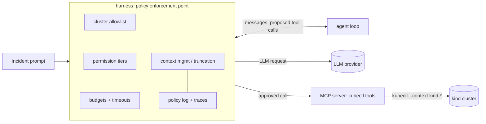

# ADR-001: Harness-centred architecture (harness ↔ agent loop ↔ MCP tools ↔ cluster)

- **Status:** proposed
- **Date:** 2026-11-03
- **Milestone:** M0

## Context
The brief asks for an agent that finds root causes in Kubernetes, but the portfolio claim is the **harness**: allowlist, permission tiers, budgets, context management, traces, injection defence. Constraints: kind/k3d only, enforced in code (#1); read-only by default, with destructive verbs hard-blocked in code, not in the prompt (#2); pluggable LLM provider (#4); readable over clever (#5). The M0 scaffold has to fix where each concern lives before M2 adds the agent. The environment also matters: cloud sessions can't run kind (PROGRESS.md, 2026-11-03), so GitHub Actions is the only place a cluster exists.

## Options
| Option | Pros | Cons |
|---|---|---|
| A. Harness is the single policy point: it wraps every LLM call and every tool call; tools run in an MCP server that executes only harness-approved kubectl argv with a pinned `--context` | Every safety rule is in one auditable layer, testable without an LLM; MCP keeps tools reusable (and usable by other agents) | We write the loop, approval hook and budgets ourselves; MCP adds a process boundary |
| B. An agent framework (LangGraph, Pydantic AI) owns the loop and tool execution; policies as framework middleware | Less loop code; built-in retries and streaming | Policy spread across framework hooks; harder to explain line by line; the "framework or none" choice is an M2 ADR anyway |
| C. Give the model a shell with kubectl; safety via prompt plus the Claude Code hook | Fastest demo | Violates #1 and #2 (prompt-level safety); nothing to evaluate as a harness |

## Decision
Option A: the harness is the only component that talks to the LLM provider and, through the MCP tool server, to the cluster. The agent loop only proposes tool calls and answers.

Code layout: `src/triage/harness/` (policy; M0 has the allowlist), `agent/` (M2), `tools/` (MCP server, M2), `evals/` (ground truth M1, scoring M4); `faults/` and `cluster/` hold the benchmark and its kind config. Where things run: unit tests anywhere; anything that needs a cluster runs in GitHub Actions with kind, and only a passing CI run counts as verified.

## Consequences
- Easier: a reviewer audits one layer; policy is unit-tested with fixtures (no cluster, no key); providers and frameworks can be swapped behind it.
- Harder / risk we accept: more code of our own than a framework demo; the MCP process boundary needs its own timeouts and error mapping (M3).
- How we'd know this was wrong: a kubectl call that doesn't go through the tools layer (a test greps for it from M2), or policy code appearing in `agent/`; or the M2 loop growing past ~300 lines by re-implementing framework features. Then revisit in the M2 framework ADR.
